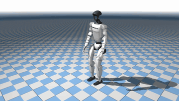
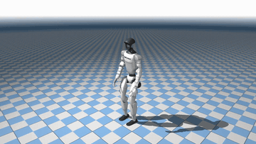
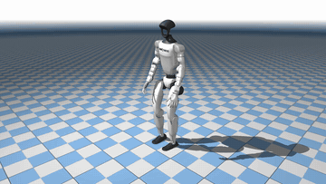
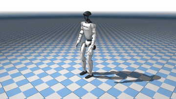
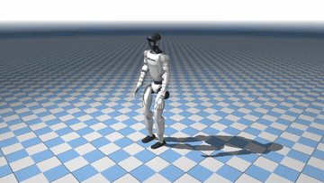
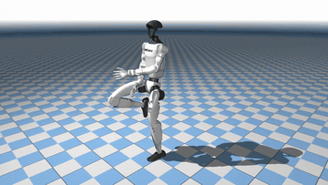

<div align="center">
  <h1>OMG-Lite</h1>
  <p>Native 50 Hz · 38D Motion Space · Streamlined Deployment</p>
  <p>
    Built on <a href="https://github.com/Tsinghua-MARS-Lab/OMG">OMG: Omni-Modal Motion Generation for Generalist Humanoid Control</a>.
  </p>
  <p>
    <a href="https://github.com/Tsinghua-MARS-Lab/OMG"></a>
    <a href="https://tsinghua-mars-lab.github.io/OMG/"></a>
    <a href="https://huggingface.co/THU-MARS/OMG/tree/main/checkpoints/38D"></a>
    <a href="docs/realtime_g1.md"></a>
  </p>
</div>

OMG-Lite adapts OMG for **native 50 Hz** humanoid motion
in a **38D pose space**, with an optimized generation–tracking deployment pipeline.

- **Native 50 Hz:** generate and track at the same rate, without runtime interpolation.
- **38D poses:** compact motion representation with matching training statistics.
- **Shared sync/async pipeline:** fixed-time plan switching, ten-frame tracker
  preview, and a separate async planner process.

<table>
  <tr>
    <td align="center" width="33%"><br>Squat down and stand up</td>
    <td align="center" width="33%"><br>Raise both arms sideways</td>
    <td align="center" width="33%"><br>Walk backward</td>
  </tr>
  <tr>
    <td align="center" width="33%"><br>Take steps to the left</td>
    <td align="center" width="33%"><br>Throw alternating punches</td>
    <td align="center" width="33%"><br>Dance</td>
  </tr>
</table>

## 1. Install

```bash
git clone https://github.com/KunYing-Lee/OMG-Lite.git
cd OMG-Lite
make venv
source .venv/bin/activate
make install
export PYTHONPATH=src
```

Use `make install-cn` for China mainland networks.
See [Installation](docs/installation.md) for dependencies.

## 2. Download and Generate

Download the [38D / 50 Hz inference bundle](https://huggingface.co/THU-MARS/OMG/tree/main/checkpoints/38D):

```bash
python - <<'PY'
from huggingface_hub import snapshot_download
snapshot_download("THU-MARS/OMG", allow_patterns=["checkpoints/38D/*"], local_dir="hf-artifacts")
PY
python hf-artifacts/checkpoints/38D/infer.py \
  --text 'walk forward' --output outputs/walk.npz
```

The bundle includes checkpoint, config, statistics and seed motion. First use
loads T5-base; no dataset or tracker is needed. See [Artifacts](docs/artifacts.md).

## 3. Train

Prepare [THU-MARS/OMG-Lite-Data and the compact cache](docs/data/multimodal_50hz.md), then run:

```bash
python -m torch.distributed.run --standalone --nproc_per_node=8 \
  -m omg.cli.generation.train exp=multimodal_50hz
```

The default predicts 100 frames from 10 history frames, using sinusoidal history
encoding and Q/K normalization. The public-data preset enables text, audio and human
reference with separate full-training-window stats. `exp=base` retains the historical
text-only protocol; see [Training](docs/training_50hz.md).

## 4. Simulate

Download [HoloMotion](https://github.com/HorizonRobotics/HoloMotion) tracking
artifacts separately. With the inference bundle above:

```bash
export OMG38_ARTIFACT_DIR="$PWD/hf-artifacts/checkpoints/38D"
python -m omg.cli.pipeline.main \
  --config "$OMG38_ARTIFACT_DIR/config.yaml" \
  --checkpoint "$OMG38_ARTIFACT_DIR/sstep=075500.ckpt" \
  --seed-motion "$OMG38_ARTIFACT_DIR/seed_stand.npz" \
  --tracker /path/to/model_16200_dynamic_batch.onnx \
  --text 'walk forward' --mode sync --frames 500 --output outputs/walk
```

Use `--mode async` for wall-clock execution. Both modes retain 50 DDIM steps and
CFG 2.5. `--switch-seconds` defaults to 1.0 and supports 0.5–2.0 seconds.
See [Generation](docs/generation.md) and [Benchmarks](docs/benchmark.md).

## 5. Deploy on G1

Run generation on the GPU host and tracking on Orin. The planner server defaults
to **DDIM20 + DiT cache, TensorRT FP16, CFG batch2**. The default pipeline
requests at frame 25 using raw frames 40–49, then switches at frame 50.
Tracker preview requires a reply within **280 ms**.

See [G1 Deployment](docs/realtime_g1.md) for setup and validation.
**The robot adapters are experimental; full shadow and physical acceptance remain pending.**

## Acknowledgements

Based on [OMG](https://github.com/Tsinghua-MARS-Lab/OMG), with motion tracking
from [HoloMotion](https://github.com/HorizonRobotics/HoloMotion).
The released inference bundle remains hosted in the upstream OMG model repository.

[MIT License](LICENSE)

